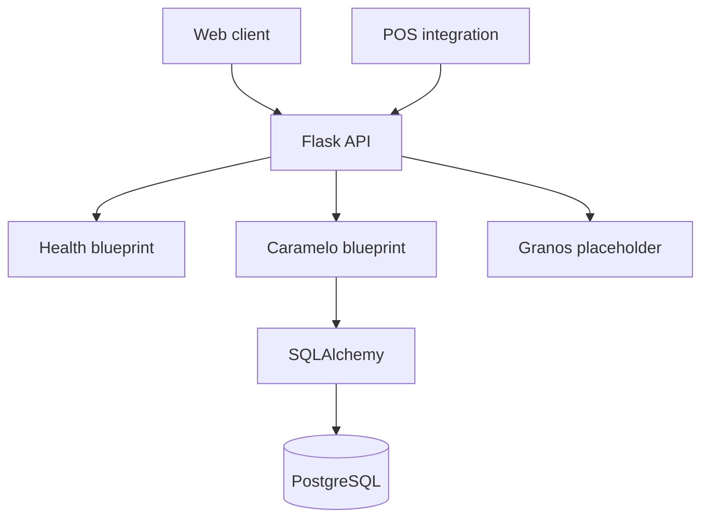

# Architecture

NeuroHub is a modular Flask API.

The application factory initializes extensions and registers blueprints. Alembic manages schema migrations. Tests can use SQLite; PostgreSQL integration tests remain necessary for database-specific behavior.

## Deployment checklist

- Explicitly set FLASK_ENV=production.
- Supply a strong SECRET_KEY and API_KEY through environment variables.
- Restrict CORS_ORIGINS to trusted clients.
- Use HTTPS and restrict database network access.
- Apply existing migrations with flask --app app:create_app db upgrade.
- Run python -m pytest before deployment.
- Review dependency audit results in CI.
- Review per-branch authorization and API key rotation before exposing synchronization endpoints.
